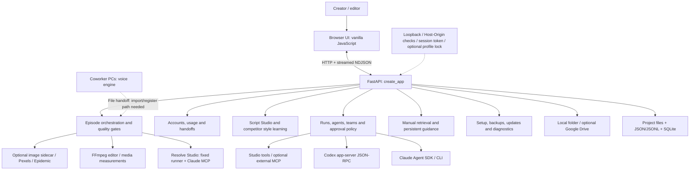

# One Production — architecture and features

Source snapshot: `main` at `fb43d19` (13 October 2026). Assessed 25 October 2026. Version: `0.10.0` plus unreleased work.

Open [the interactive architecture artifact](architecture-and-features.html) for component exploration, searchable features, workflow and implementation gaps.

## Architecture

One Production is a **local Windows application**, with a browser interface, a Python/FastAPI backend, local files and SQLite databases, and optional external programs/services. It does not have a shared team backend or distributed worker scheduler.

The diagram groups responsibilities. `app/main.py` is the composition root and also contains many routes; these are not independently deployed services. Optional voice/image servers and AI/Resolve programs run as separate processes.

## Components and source map

| Layer | Responsibility | Main source |
|---|---|---|
| Launcher | Read settings, create data folders, choose loopback port starting at 8730, open browser with session token | `app/__main__.py`, `app/config.py`, `start.bat` |
| Browser | Projects/chat, accounts/usage and specialized feature panels | `web/index.html`, `web/episode.js`, `web/competitors.js`, `web/knowledge.js`, `web/resolve.js`, `web/mcp.js`, `web/storage.js` |
| HTTP application | Construct services, mount routes, manage lifecycle and stream run events | `app/main.py`, `app/*_api.py` |
| Security | Request token/Host/Origin checks, profile lock, tool policies, heavy-job approvals, redaction | `app/security/`, `app/profile.py`, `app/agent/policy.py`, `app/tools.py` |
| Agent execution | Claude SDK adapter, Codex app-server adapter, studio tools, run state and approval futures | `app/agent/claude_agent.py`, `codex_agent.py`, `studio.py`, `runs.py` |
| Orchestration | Team workers/reviews, script loop, style analysis and episode stages | `app/agent/team.py`, `scriptflow.py`, `style_learn.py`, `episode.py` |
| Accounts and usage | Isolated provider profiles, model choices, ledger, spend caps, handoff and switching | `app/accounts.py`, `app/models.py`, `app/usage.py`, `app/handoff.py` |
| Voice | Local HTTP service, Chatterbox, read-check, mastering, subtitles and tuning | `voice/`, `app/voice.py` |
| Visual production | Resolve plans, fixed helper, direct Claude Resolve MCP, Fusion compositions and kit | `app/resolve.py`, `app/resolve_runner.py`, `app/resolve_mcp.py`, `app/fusion.py`, `app/fusion_kit.py` |
| Media and assets | FFmpeg editing/measurement, generated images, stock, SFX, output gates and bundle | `app/editor.py`, `app/media.py`, `app/assets.py`, `imagegen/`, `app/stock.py`, `app/sfx.py`, `app/gates.py`, `app/packaging.py` |
| Knowledge | FTS5 document retrieval/citations, scoped directions, verified recipes and retention lessons | `app/knowledge.py`, `app/learning.py`, `app/insights.py` |
| Storage/platform | Project files, cloud export/import, MCP config, backup/setup/install/update/support | `app/storage.py`, `app/cloud_storage.py`, `app/mcp_servers.py`, `app/backups.py`, `app/installer.py`, `app/update.py`, `app/diagnostics.py` |
| Development | Cumulative test gates, package/release tools and optional isolated coding dispatch | `tools/`, `tests/p0`–`tests/p12`, `dev/dispatch.py` |

## Feature inventory

Implemented means a code path exists; it does not imply that every integration has passed a real production check.

| Feature group | Capabilities | Requirements / limits |
|---|---|---|
| Projects and chat | Project creation, chat history, streaming replies, file upload/preview/download, suggestions | Local installation; real AI requires a configured account |
| Accounts | Multiple isolated Claude/Codex profiles, Anthropic API keys, pasted Claude token support, model/effort controls | Credentials configured independently on each workstation |
| Usage and continuity | Usage/cost breakdowns, live limit information where available, caps, exports, switch/limit logs and context handoffs | Provider-specific data sources; same-service chaining guarded by app configuration |
| Agents and teams | File/tool access, approval cards, scoped permissions, master/worker orchestration, concurrency and review budgets | One live run per project; live teams do not survive app restart |
| Script Studio | Competitor captions, text/list input, FacelessOS guidance, analyst/writer/reviewer loop | AI account; yt-dlp for YouTube inputs |
| Competitor styles | Cut/picture/audio measurement, keyframes/contact sheets, AI visual analysis, reusable profiles | FFmpeg, yt-dlp and Claude/API account for frame inspection |
| Voice production | Reference cloning, read-check/retries, pace shaping, tuning, WAV/MP3/SRT output and mastering | **Runs on coworkers’ computers in your workflow**; separate dependencies/models |
| Episodes | Script → voice → visuals → render → package; progress snapshots, flags and selected-stage retries | Reused narration must currently be a finished job in the same project |
| Resolve | Validated disposable-project edit plans; Claude direct MCP; Fusion shot timing, stills, kit v4 and draft renders | Resolve Studio scripting support; appropriate app switches. Codex does not receive direct Resolve MCP |
| Images and stock | FLUX object/scene generation, BiRefNet cutouts, Pexels footage/photos and credits | Optional GPU image installation/Hugging Face access; Pexels key |
| Sound effects | Epidemic search/download/cache and timed placement | Optional service key and suitable access |
| Media checks | Voice WER/pitch/loudness/peak/SRT coverage; video duration/sync/black frames/resolution; package constraints | Synthetic/stand-in tests establish logic, not finished-video quality |
| Delivery | Video, subtitle, thumbnail, title options, description, chapters and metadata bundle | No direct YouTube publishing workflow established by this assessment |
| Knowledge and memory | PDF/DOCX/Markdown/text import, page citations, FTS5 search, scoped guidance, corrections, forgetting, verified recipes | Local retrieval/context; no model-weight training |
| Retention learning | Import audience-retention CSV, map drops to episode context, suggest lessons for approval | Needs a real published episode/export to validate fully |
| Storage | Selected-folder copy/import and optional Google Drive browse/import/resumable upload | Not collaborative project synchronization |
| MCP | Custom stdio/HTTP/SSE servers, enable switches, secret headers and tool-list probes | External MCP reaches Claude; calls follow the app policy |
| Installation/support | First-run wizard, system scan, optional modules, backups/restore, PIN/Google sign-in and redacted diagnostics | Heavy models are separate from core dependencies |
| Distribution | Embedded-Python Windows zip, manifests, update source, side-by-side versions and rollback | Source checkout does not self-update; imagegen packaging gap remains |
| Development | Phase test runner and optional model dispatch/worktrees/cross-model review | Dev dispatch is not shipped to end users |

## Production workflow and team responsibilities

1. **Script preparation:** supply a finished script, or use competitor analysis → writer → reviewer loop.
2. **Voice production — coworkers:** generate/read-check/master narration and produce subtitles on their computers.
3. **Voice handoff:** transfer audio and SRT into the editing project. A first-class import/register flow is still needed for automated episodes; arbitrary uploads do not become a `voice_job` automatically.
4. **Visual production:** art direction → timed shots → Resolve/Fusion scripts → stills → QA. Optional style profiles, generated plates/objects, Pexels and SFX feed this stage.
5. **Render:** draft mode can render through Resolve; review-driven mode waits for the owner to render and select the file. Measure the result.
6. **Package and review:** assemble output files/metadata, validate package constraints and optionally copy to storage.
7. **Post-publication:** import retention data and approve useful suggested lessons.

**Draft mode:** some quality failures become review flags; a completed draft does not necessarily pass all production gates. Unreadable scripts, failed voiceover, unavailable Resolve and failed renders can still stop progress.

**Review-driven mode:** shot scripts appear on approval cards and the owner supplies the render. Both modes reuse the episode/team/run infrastructure.

## Data and trust boundaries

- Browser requests stay on loopback by default. API calls require a session token; optional PIN/Google profile lock sits above that.
- Default data root: `%LOCALAPPDATA%\OneProduction`. Default settings: `%APPDATA%\OneProduction\settings.json`; relevant `ONEPROD_*` variables override file settings.
- Project state uses files, JSON and JSONL; usage and knowledge use local SQLite stores.
- App-managed secrets use Windows Credential Manager. Provider clients manage login state in isolated profile directories.
- Voice/image sidecars are local HTTP processes, defaulting to ports 8720 and 8722. They are not remote worker schedulers.
- Cloud AI and configured integrations receive the information required by their calls; local storage does not imply all processing is offline.
- Tool policy distinguishes allow/ask/gate/deny. Draft own-shot scripts have a scoped exception. Unsafe Resolve scripting is denied.

## Open architecture and product work

1. Add or validate a coworker audio handoff that registers WAV/SRT/source-script output as a finished project voice job.
2. Recover the friend's unpushed `wip/pro-motion-kit` branch; main has kit v4. The handoff says the first v5 render failed.
3. Improve visual quality and stability using real saved draft evidence. Voice loudness/subtitle timing issues remain relevant on the coworkers’ voice installation.
4. Add `imagegen/` to the package build’s shipped files; runtime setup currently expects files that its copy list omits.
5. Complete real Google Drive and other pending integration/manual checks; choose update hosting and refresh release version/documentation.
6. Storyblocks, NexLev/vidIQ research workers, remote job dispatch and shared team synchronization are not implemented.

Recorded approvals reach P6. P7–P12 are implemented with outstanding manual gates. See [the takeover assessment](TAKEOVER-2026-10-25.md) for installation, hardware and test details. No paid AI calls or GPU workloads were used for this artifact.
